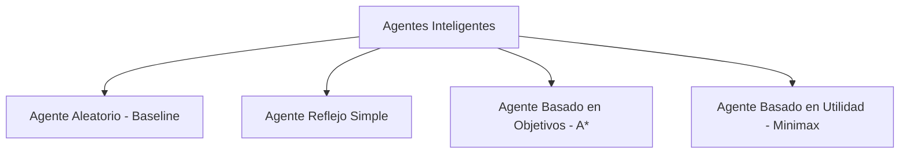

# Neo Bomberman Tactical IA - Grupo 9

Simulador táctico multiagente y banco de pruebas de Inteligencia Artificial desarrollado sobre una arquitectura web interactiva en Python. El proyecto implementa, compara y recolecta telemetría de agentes inteligentes con distintas taxonomías de toma de decisiones (reactivos, basados en objetivos y basados en utilidad) compitiendo en un entorno de cuadrícula discreta, con persistencia para entrenamiento de modelos predictivos de Machine Learning.

---

## 🎯 Definición del Problema

En entornos dinámicos, multiagente y con riesgo fatal diferido (bombas con temporizadores de detonación), la toma de decisiones en tiempo real representa un reto clásico de la IA:
* Los agentes deben balancear **supervivencia a corto plazo** (evadir zonas de peligro y no quedar acorralados) con **planificación táctica a mediano plazo** (caza del oponente y colocación estratégica de bombas).
* Este entorno modela problemas del mundo real como enrutamiento en almacenes robotizados con obstáculos móviles, vehículos autónomos en intersecciones críticas y sistemas de evacuación en zonas de catástrofe.

---

## 📊 Estructura del Entorno: Marco PEAS

| Componente | Especificación Técnica |
| :--- | :--- |
| **P (Performance / Rendimiento)** | • Tasa de supervivencia y victorias por partida.<br>• Minimización del costo computacional (tiempo de inferencia en ms).<br>• Eficiencia en el espacio de búsqueda (nodos expandidos por acción). |
| **E (Environment / Entorno)** | • **Completamente Observable:** Se percibe la matriz completa (muros, cajas, posiciones de jugadores y bombas).<br>• **Determinista:** Movimientos sin deslizamiento ni incertidumbre en el actuador.<br>• **Dinámico / Secuencial:** Las bombas decrementan su temporizador independientemente y cada acción condiciona el futuro.<br>• **Discreto y Multiagente:** Cuadrícula 2D con competencia de suma cero. |
| **A (Actuators / Actuadores)** | • Acciones discretas: `Arriba`, `Abajo`, `Izquierda`, `Derecha`, `Poner Bomba`, `Quieto`. |
| **S (Sensors / Sensores)** | • Percepción estructurada vía diccionario (`estado`): coordenadas de agentes, lista de bombas con temporizador y alcance, matriz de obstáculos y distancias relativas. |

---

## 🤖 Jerarquía y Taxonomía de Agentes Inteligentes

El sistema cuenta con 4 arquitecturas de agentes implementadas en `agentes.py`, permitiendo comparativas empíricas directas:



1. **Agente Aleatorio (`AgenteAleatorio` - Baseline):**
   * Selección estocástica uniforme de acciones viables.
   * Sirve como cota inferior (benchmark) para medir la ganancia real de los algoritmos avanzados.
2. **Agente Reflejo Simple (`AgenteReflejo`):**
   * Reglas de producción *Condición-Acción*.
   * Evalúa la vecindad inmediata (perímetro 1) y descarta movimientos hacia casillas con amenaza inminente de explosión.
3. **Agente Basado en Objetivos (`AgenteAEstrella` - A\* Pathfinding):**
   * Planificación deliberativa con heurística admisible de distancia de Manhattan: $f(n) = g(n) + h(n)$.
   * Estructura de datos: Cola de prioridad (`heapq`).
   * Rastrea la ruta óptima para interceptar la posición objetivo del rival.
4. **Agente Basado en Utilidad (`AgenteMinimax` - Heurístico Profundidad 1):**
   * Evalúa estados futuros mediante una función de utilidad multicriterio ponderada:
     $$U(s) = w_1 \cdot \text{Seguridad} + w_2 \cdot \text{ProximidadRival} + w_3 \cdot \text{PresiónBomba}$$
   * Penalización crítica ante radio de explosión (-1000) y recompensa por posicionamiento táctico (+50).

---

## 🛠️ Stack Tecnológico

* **Lenguaje Core:** Python 3.10+
* **Framework Web & Visualización:** [Streamlit](https://streamlit.io/) (Renderizado dinámico de tableros mediante SVG y componentes reactivos).
* **Persistencia & Telemetría:** SQLite3 (`telemetria.db`) para logging de cada decisión, métrica y partida en tiempo real.
* **Procesamiento de Datos:** Pandas & NumPy (análisis de series temporales de partidas y extracción tabular de features).
* **Visualización de Métricas:** Matplotlib / Seaborn integrados en el dashboard de telemetría.
* **Despliegue:** Streamlit Community Cloud.

---

## 📈 Banco de Telemetría y Dataset para Machine Learning

Cada turno ejecutado en el simulador queda registrado en `telemetria.db` mediante el módulo `database.py`:
* **Tabla `partidas`:** ID de partida, algoritmo seleccionado, resultado (Victoria/Derrota/Empate), total de turnos y timestamp.
* **Tabla `decisiones`:** Paso a paso de cada movimiento: estado del tablero (JSON), acción elegida, tiempo de cómputo (ms) y nodos explorados.

> **Rumbo a Machine Learning (Fase Predictiva):**
> Esta recolección sistemática de datos constituye el *Ground Truth* para entrenar clasificadores y modelos predictivos (Imitation Learning / Behavioral Cloning y Modelos Predictivos de Supervivencia), reduciendo la complejidad computacional de Minimax/A* de tiempo deliberativo $O(b^d)$ a inferencia $O(1)$.

---

## 🚀 Instalación y Ejecución

### 1. Clonar el repositorio
```bash
git clone https://github.com/jussepe06/AI-Grupo-9-Snake-juego-proyecto-final.git
cd AI-Grupo-9-Snake-juego-proyecto-final
```

### 2. Crear entorno virtual e instalar dependencias
```bash
# Crear entorno virtual (opcional pero recomendado)
python -m venv venv
venv\Scripts\activate   # En Windows
# source venv/bin/activate # En Linux/Mac

# Instalar librerías
pip install -r Bomberman/Bomberman/requirements.txt
```

### 3. Ejecutar la aplicación
```bash
streamlit run Bomberman/Bomberman/app.py
```
La aplicación abrirá automáticamente en tu navegador predeterminado en `http://localhost:8501`.

---

## 📂 Estructura del Repositorio

```text
├── Bomberman/
│   └── Bomberman/
│       ├── app.py                # Dashboard principal de Streamlit (Arena y Telemetría)
│       ├── agentes.py            # Implementación de los 4 agentes (Aleatorio, Reflejo, A*, Minimax)
│       ├── bomberman_env.py      # Motor del juego, físicas, bombas y ciclo de turnos
│       ├── database.py           # Conexión SQLite, persistencia y exportación a Pandas
│       ├── experimentos.py       # Scripts para simulaciones por lotes y pruebas estadísticas
│       ├── telemetria.db         # Base de datos SQLite con histórico de partidas
│       └── requirements.txt      # Dependencias del proyecto
└── README.md                     # Documentación técnica general
```

---

## 👥 Integrantes y Roles

* **Integrante 1:** Arquitectura de Agentes Inteligentes (A* y Minimax), modelado de heurísticas y funciones de utilidad.
* **Integrante 2:** Desarrollo del motor del entorno (`bomberman_env.py`), sistema de físicas y simulación por turnos.
* **Integrante 3:** Dashboard en Streamlit, módulo de persistencia SQLite (`database.py`) y telemetría analítica.

---

## 🤖 Declaración de Uso de IA
Se utilizaron herramientas de IA asistida para acelerar la estructuración de la interfaz interactiva en Streamlit, optimización de consultas SQL y refactorización del pipeline de telemetría. La formulación matemática de las heurísticas de búsqueda y las funciones de utilidad fueron diseñadas y calibradas por el equipo de desarrollo.
